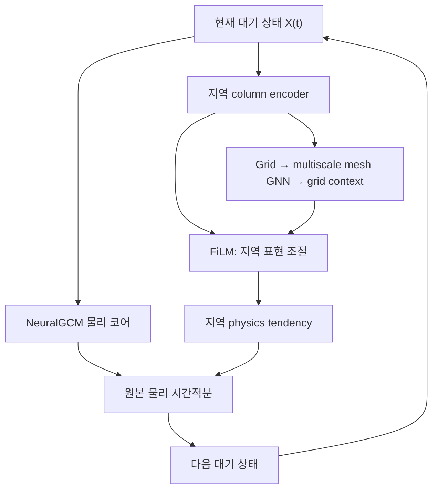

# NeuralGCM for Graph

**Local physics + multiscale global context → mesh-conditioned NeuralGCM.**

GraphCast의 구면 메시 정보 전달 방식을 이용해 NeuralGCM의 지역 물리
parameterization을 조건화하는 연구용 첫 구현입니다. NeuralGCM의 전 지구
동역학 코어는 유지하고, GNN이 계산한 문맥을 지역 물리 신경망에 FiLM으로
주입합니다. 새로 학습할 모델이며, 기존 사전학습 체크포인트를 그대로 불러와
동일한 예측을 보장하는 패치는 아닙니다.



$$
z_i=E(X_i),\qquad c_i=\mathrm{Mesh2Grid}(\mathrm{GNN}(\mathrm{Grid2Mesh}(z)))_i,
$$
$$
\widetilde z_i=(1+\gamma(c_i))\odot z_i+\beta(c_i),\qquad
\dot X=\mathcal D(X)+\mathcal P_\theta(\widetilde z).
$$

매 physics step에서 **현재 상태로 문맥을 다시 계산**합니다. 예제에서 사용하는
원본 corrector는 한 physics step 안의 IMEX 내부 stage 동안 tendency를 고정합니다.
별도의 recurrent memory/noise 모델은 이번 구현의 범위에 포함하지 않습니다.

## 구현 범위

- 단계별 정이십면체 세분화와 coarse/fine edge를 합친 다중 해상도 구면 메시
- 학습 가능한 grid→mesh, mesh→mesh, mesh→grid 메시지 전달
- 원래 격자의 지역 표현을 유지하는 local 경로와 bounded FiLM adapter
- 초기 FiLM을 0으로 설정: 동일한 지역 신경망 가중치에서 adapter 영향이 0
- 지역 전용 / 이웃 격자 / 다중 해상도 메시 비교 옵션
- 면적 가중 다단계 학습 손실, zonal-mean 보조 손실, 실제 pressure-level
  meridional wind의 mass-streamfunction 감독 손실
- 실제 NeuralGCM `DivCurlNeuralParameterization` 연결과 Dinosaur 물리 적분 검증

ECMWF 저장소는 GraphCast 실행·입출력 래퍼입니다. 메시 알고리즘은 GraphCast
원본도 함께 확인해 구현했습니다. 원본 코드, 정확한 revision, 이번 구현의
차이는 [UPSTREAM.md](UPSTREAM.md)에 정리했습니다. 특히 현재 grid↔mesh 연결은
sparse k-nearest-neighbor 방식이며 GraphCast의 radius/containing-triangle
연결을 그대로 복제하지는 않았습니다.

## 설치

Python 3.12 CPU 환경에서 검증합니다. GPU 설치는 장비에 맞는 JAX를 먼저
설치하고 같은 프로젝트 의존성을 설치하세요.

```bash
git clone https://github.com/nayehyeon61-glitch/Neural_GCM_for_Graph.git
cd Neural_GCM_for_Graph
python3 -m venv .venv
source .venv/bin/activate
python -m pip install --upgrade pip
python -m pip install -e '.[test,neuralgcm]' -c constraints-tested.txt
pytest -q
```

GNN과 합성 학습만 확인하려면 `.[test]`로 설치할 수 있습니다. 실제 물리
코어 예제에는 `neuralgcm` extra가 필요합니다. `constraints-tested.txt`는
검증한 주요 Python 패키지 버전, `pyproject.toml`은 원본 저장소 commit을
고정합니다.

## 실행

실제 NeuralGCM/Dinosaur 코어와 adapter의 연결 확인:

```bash
python examples/neuralgcm_smoke.py
```

합성자료로 A–D 학습 경로 확인:

```bash
python examples/train_toy.py --config configs/A_local.json --steps 30 --output runs/A.json
python examples/train_toy.py --config configs/B_neighbor.json --steps 30 --output runs/B.json
python examples/train_toy.py --config configs/C_mesh.json --steps 30 --output runs/C.json
python examples/train_toy.py --config configs/D_circulation.json --steps 30 --output runs/D.json
```

| 실험 | `context_mode` | 문맥 입력 | 목적 |
| --- | --- | --- | --- |
| A | `none` | 지역 column | 같은 새 지역 신경망의 기준선 |
| B | `local` | 이웃 격자 | 근거리 정보 효과 |
| C | `mesh` | 다중 해상도 메시 | 광역 문맥 효과 |
| D | `mesh` | C + 순환 보조 손실 | 순환 관련 감독 효과 |

JSON 결과와 NPZ 가중치를 저장합니다. **합성 학습 수치는 실제 기후 예측
성능을 뜻하지 않습니다.** 예제 D의 순환 보조 손실은 toy field의 공간 평균
진단에 대한 비교이며 실제 Hadley/Walker cell 검증과 구분해야 합니다.
B와 C는 기본 설정에서 파라미터 수가 같지 않습니다. 출력된 parameter count를
확인해 용량·연산량을 맞춘 추가 비교가 필요합니다.
합성 비교에서는 지역 encoder/decoder의 초기 가중치를 A–D 사이에 동일하게
맞춥니다. 물리적 D 실험에는 `mass_streamfunction_mse`를 사용할 수 있으며,
pressure-level 변환과 학습자료 기반 `scale_kg_s`를 명시적으로 제공해야 합니다.

## NeuralGCM에 연결

`src/neuralgcm_graph/integration.py`는 원본 Haiku/Gin 인터페이스를 사용합니다.
`graph_from_coords(coords)`로 실제 물리 격자 좌표와 Gaussian 적분 가중치에
맞춘 topology를 **JIT 밖에서 한 번** 만든 뒤
`MeshConditionedNeuralParameterization`에 전달합니다. 입력 특징의 정규화,
tendency의 단위 변환·필터링, prediction mask는 원본 구성을 전달합니다.

물리 신경망은 `(channels, longitude, latitude)`를 받습니다. 여러 수직
level은 column feature로 들어가고, 출력은 `u`, `v`, 온도, 기압, tracer 등
prediction mask에 포함된 tendency 구조로 돌아갑니다. 원본 클래스가
`u/v → divergence/vorticity`와 spectral 변환을 수행합니다.

FiLM이 0이어도 **새 지역 encoder/decoder가 사전학습 NeuralGCM의 가중치가
되는 것은 아닙니다.** 사전학습 모델을 보존하는 fine-tuning에는 원본 tower를
유지하는 별도 가중치 이식과 예측 동일성 검증이 필요합니다.

## 실자료 실험 전 준비

1. ERA5 pressure-level 자료를 모델의 Gaussian 수평 격자와 sigma 수직
   좌표로 변환하고 단위·정규화·표면기압·지형·forcing을 정합합니다.
2. 초기 상태와 미래 target sequence를 시간 순서로 준비하고 학습/검증/시험
   기간을 분리합니다. 정규화 통계는 학습 구간에서만 계산합니다.
3. 원본 코어를 통과하는 multi-step rollout loss로 학습하고 lead time을
   점진적으로 늘립니다. 단일 시점 tendency 회귀만으로 대체하지 않습니다.
4. RMSE/ACC 외에도 질량·에너지 drift, 바람 스펙트럼, zonal-mean 바람,
   pressure-coordinate mass streamfunction, ENSO 원격상관을 검증합니다.

이 저장소는 ERA5 원시 NetCDF를 자동으로 공식 NeuralGCM 학습자료로 바꾸는
완성된 전처리 파이프라인이나 학습된 체크포인트를 포함하지 않습니다.
실험 설계와 구현 한계는 [docs/research_protocol.md](docs/research_protocol.md),
실행 검증 결과는 [docs/validation.md](docs/validation.md)를 참고하세요.
